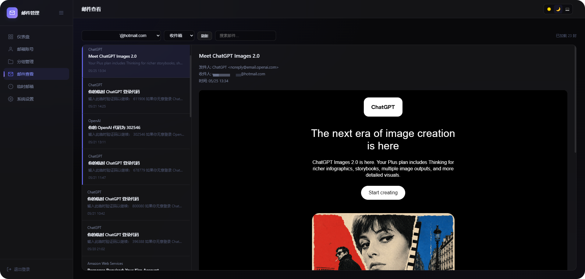
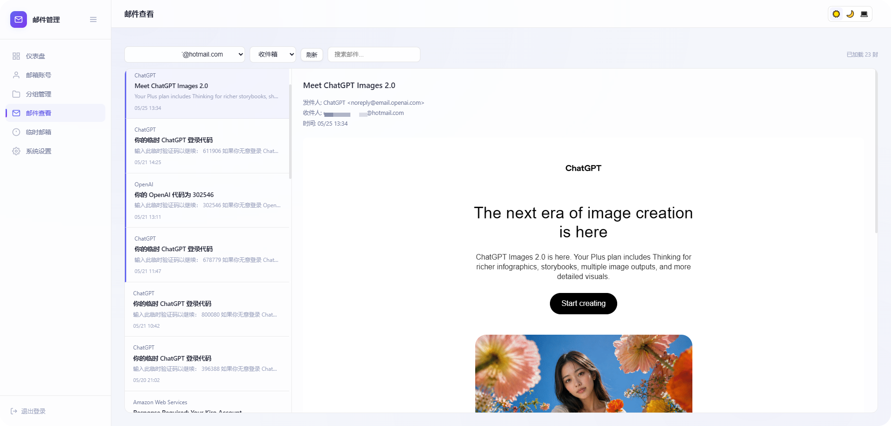

# 📬 Outlook Email Manager

<div align="center">

**Lightweight Outlook email manager powered by Cloudflare Workers**

🆓 100% Free · ☁️ No Server Required · 🌍 Global CDN · 🌗 Dark/Light Theme · 🌐 Bilingual UI

[](./LICENSE)
[](https://www.typescriptlang.org/)
[](https://workers.cloudflare.com/)
[](https://hono.dev/)
[](https://developers.cloudflare.com/d1/)
[](https://github.com/roseforyou/cf-outlook-email/pulls)

[](https://deploy.workers.cloudflare.com/?url=https://github.com/keweiya/cf-outlook-email)

⚠️ This button **cannot one-click deploy** this project: it relies on a D1 database and Secrets, which require manually creating the DB, running migrations, and setting secrets — the button fails at framework detection. Please follow the 📖 [Deployment Guide](./docs/GUIDE.md) instead (~5 min).

🌐 [中文](./README.md) · 📖 [Deployment Guide](./docs/GUIDE.md) · 🔌 [API Docs](./docs/API.md)

</div>

---

| 🌙 Dark | ☀️ Light |
|:---:|:---:|
|  |  |

## ✨ Features

- 🔐 **One-Click OAuth** — Authorize Outlook accounts via browser popup, no manual token copying
- 🔄 **Auto Token Refresh** — Automatically saves new refresh tokens on each use, preventing expiry
- 📦 **Batch Operations** — Import/export/delete/move in bulk, including per-row & selected export, with group & status filters
- 📨 **Email Reading** — Read inbox / junk / deleted via Microsoft Graph API with folder switching, aggregated view, paginated load-more, search and HTML rendering
- 📭 **Temp Email** — GPTMail API integration for disposable email addresses
- 🎨 **Polished Themes** — Dark / Light / Auto with glassmorphism, circle-swoop transition & ambient breathing glow
- 🌐 **Bilingual UI** — Chinese by default, one-click switch to English in the topbar, preference remembered locally, backend messages translated on display
- 🆓 **Completely Free** — Runs on Cloudflare's free tier, no credit card needed

## 🚀 Deploy: four steps, all in the Cloudflare dashboard

> **No database is pre-provisioned.** The first deployment *will* be unusable — there is no D1 yet.
> You create, initialize and bind the database yourself; the second deployment works.

1. Fork this repo → Cloudflare → **Workers & Pages → Create → Import a repository** (or click the **Deploy to Cloudflare** button, Worker name `outlook-email`). Build succeeds, the site loads, but the API reports "database not ready" — expected.
2. **Storage & Databases → D1 → Create** named `outlook-email-db`, open its **Console** and run the SQL block below.
3. Your Worker → **Settings → Bindings → Add → D1 database**, Variable name **`DB`**; then **Settings → Variables and Secrets** → add `ADMIN_PASSWORD` and `COOKIE_SECRET` (random 32+ chars).

<details open>
<summary><b>SQL for step 2 (copy the whole block into the D1 Console)</b></summary>

```sql
-- ── 0001_init.sql ──
-- settings: login password hash, site config, GPTMail config, etc.
CREATE TABLE IF NOT EXISTS settings (
  key        TEXT PRIMARY KEY,
  value      TEXT NOT NULL,
  created_at TEXT DEFAULT CURRENT_TIMESTAMP,
  updated_at TEXT DEFAULT CURRENT_TIMESTAMP
);

-- groups: email account groups
CREATE TABLE IF NOT EXISTS groups (
  id          INTEGER PRIMARY KEY AUTOINCREMENT,
  name        TEXT NOT NULL UNIQUE,
  description TEXT DEFAULT '',
  color       TEXT DEFAULT '#2563eb',
  created_at  TEXT DEFAULT CURRENT_TIMESTAMP,
  updated_at  TEXT DEFAULT CURRENT_TIMESTAMP
);
INSERT OR IGNORE INTO groups (id, name, description, color)
VALUES (1, '默认分组', '默认邮箱分组', '#2563eb');

-- accounts: Outlook email accounts
CREATE TABLE IF NOT EXISTS accounts (
  id            INTEGER PRIMARY KEY AUTOINCREMENT,
  email         TEXT NOT NULL UNIQUE,
  client_id     TEXT NOT NULL,
  refresh_token TEXT NOT NULL,
  password      TEXT DEFAULT '',
  group_id      INTEGER DEFAULT 1,
  remark        TEXT DEFAULT '',
  status        TEXT DEFAULT 'active',
  created_at    TEXT DEFAULT CURRENT_TIMESTAMP,
  updated_at    TEXT DEFAULT CURRENT_TIMESTAMP,
  FOREIGN KEY (group_id) REFERENCES groups(id)
);

-- temp_emails: temporary email records
CREATE TABLE IF NOT EXISTS temp_emails (
  id         INTEGER PRIMARY KEY AUTOINCREMENT,
  email      TEXT NOT NULL UNIQUE,
  source     TEXT DEFAULT '',
  remark     TEXT DEFAULT '',
  created_at TEXT DEFAULT CURRENT_TIMESTAMP,
  updated_at TEXT DEFAULT CURRENT_TIMESTAMP
);

-- ── 0002_tags.sql ──
-- tags: free-form labels for accounts (many-to-many, complements single-select groups)
CREATE TABLE IF NOT EXISTS tags (
  id         INTEGER PRIMARY KEY AUTOINCREMENT,
  name       TEXT NOT NULL UNIQUE,
  color      TEXT DEFAULT '#6366f1',
  created_at TEXT DEFAULT CURRENT_TIMESTAMP
);

-- account_tags: join table
CREATE TABLE IF NOT EXISTS account_tags (
  account_id INTEGER NOT NULL,
  tag_id     INTEGER NOT NULL,
  PRIMARY KEY (account_id, tag_id),
  FOREIGN KEY (account_id) REFERENCES accounts(id) ON DELETE CASCADE,
  FOREIGN KEY (tag_id) REFERENCES tags(id) ON DELETE CASCADE
);
CREATE INDEX IF NOT EXISTS idx_account_tags_tag ON account_tags(tag_id);

-- ── 0003_push_state.sql ──
-- push_state: per-account watermark for Telegram new-email push.
-- last_pushed_at holds the receivedDateTime (ISO string) of the newest email
-- already pushed, so each cron run only forwards strictly newer messages.
CREATE TABLE IF NOT EXISTS push_state (
  account_id     INTEGER PRIMARY KEY,
  last_pushed_at TEXT DEFAULT '',
  updated_at     TEXT DEFAULT CURRENT_TIMESTAMP,
  FOREIGN KEY (account_id) REFERENCES accounts(id) ON DELETE CASCADE
);
```

Verify:

```sql
select name from sqlite_master where type='table' and name not like 'sqlite_%' order by name;
```

Expected 7 tables: `account_tags, accounts, groups, push_state, settings, tags, temp_emails` (`sqlite_sequence` is internal and filtered out).

</details>
4. Saving the binding already deploys a new version — just reload the page. Open `https://<worker>.<subdomain>.workers.dev` and log in.

Do not mix the two modes: a later `git push` / `Retry deployment` deploys from `wrangler.toml`, which has no D1 binding, so a dashboard-added binding can be overwritten. Long-term Git deployments should declare `[[d1_databases]]` in `wrangler.toml`. Note that an environment variable cannot replace a D1 binding — `env.DB` must be a binding object with `.prepare()`.

Any fork follows the same four steps; swap the repo URL in the button:
`https://deploy.workers.cloudflare.com/?url=<YOUR_REPO_URL>`. Details: [docs/DEPLOY-CLOUDFLARE.md](./docs/DEPLOY-CLOUDFLARE.md).

> 💡 Prefer the CLI? See the [Deployment Guide](./docs/GUIDE.md) for full steps.

```bash
# 1. Clone & install
git clone https://github.com/roseforyou/cf-outlook-email.git
cd cf-outlook-email
pnpm install

# 2. Login to Cloudflare
pnpm exec wrangler login

# 3. Create D1 database (copy database_id to wrangler.toml)
pnpm exec wrangler d1 create outlook-email-db
cp wrangler.toml.example wrangler.toml
# Edit wrangler.toml, replace REPLACE_WITH_YOUR_DATABASE_ID

# 4. Set secrets
pnpm exec wrangler secret put ADMIN_PASSWORD
pnpm exec wrangler secret put COOKIE_SECRET

# 5. Initialize & deploy
pnpm exec wrangler d1 migrations apply outlook-email-db --remote
pnpm exec wrangler deploy
```

Visit the output URL and login with your password. 🎉

## 📮 Adding Accounts

Login → **Add Account** → **One-Click Auth** → Microsoft login popup → Authorize → Credentials auto-filled → Save.

Works with all Outlook / Hotmail / Live accounts. Bulk import supported (format: `email----password----client_id----refresh_token`).

## 🧱 Tech Stack

| Layer | Technology |
|-------|-----------|
| ⚙️ Runtime | Cloudflare Workers (TypeScript) |
| 🧭 Router | Hono |
| 🗄️ Database | Cloudflare D1 (SQLite) |
| 🎨 Frontend | Vanilla HTML/CSS/JS |
| 📧 Email | Microsoft Graph API |
| 🚀 Deploy | Wrangler |

## 💰 Free Tier Limits

| Resource | Free Quota | Sufficient? |
|----------|-----------|:-----------:|
| ⚡ Worker Requests | 100K/day | ✅ |
| ⏱️ CPU Time | 10ms/req | ✅ |
| 🌐 Subrequests | 50/req | ✅ (single account per request) |
| 💾 D1 Storage | 5 GB | ✅ |

## 🗺️ Roadmap

**Core features (implemented)**

- [x] 🔐 One-click OAuth & auto token refresh
- [x] 👤 Account management (CRUD, connection test)
- [x] 🗂️ Group management (custom colors, group & status filters)
- [x] 📦 Bulk import / export / delete / move
- [x] 📤 Per-row & selected export
- [x] 📨 Email reading (live fetch, search, HTML rendering)
- [x] 📁 Folder switching (Inbox / Junk / Deleted)
- [x] 🔀 Aggregated view (Inbox + Junk merged by time — great for finding codes)
- [x] 📄 Paginated load-more
- [x] 📭 Temp email (GPTMail integration)
- [x] 🎨 Theme switching + circle-swoop transition + breathing glow
- [x] 🔑 External API + API Key (login-free email fetch for automation, see [API Docs](./docs/API.md))
- [x] 🗑️ Delete emails (single / batch, soft-delete to Deleted Items)
- [x] 📎 Attachment download
- [x] 🏷️ Tag system (multiple tags per account, cross-group filtering)
- [x] ⏰ Scheduled token refresh (Cron Trigger, configurable interval/batch, keeps accounts alive)
- [x] 🤖 Telegram push for new emails (cron polling, near-real-time delivery, configurable interval)
- [x] 🧭 UI polish (per-page toolbars, dashboard health cards, responsive settings grid, paginated accounts table, searchable account combobox)
- [x] 🌐 UI internationalization (Chinese default, one-click English)

**Planned (PRs welcome)**

- [ ] 🔔 More push channels (WeCom / DingTalk etc.)

> ⚠️ Due to Cloudflare Workers platform limits, the following are not feasible: IMAP (Gmail / QQ / 163 and other non-Microsoft mailboxes), SMTP forwarding, HTTP/SOCKS5 proxy.

## ⚠️ Disclaimer

This project is intended for personal use to manage your own email accounts. Ensure you have legal authorization for all accounts you manage. The default Client ID is Mozilla Thunderbird's public ID for quick setup only — registering your own Azure app is recommended for production use. The author assumes no liability for any misuse.

## 🙏 Credits

This project is a rewrite of [xiaozhi349/outlookEmail](https://github.com/xiaozhi349/outlookEmail), originally built with Python Flask + SQLite. It has been migrated to Cloudflare Workers + D1 with a completely new frontend and backend. Thanks to the original author.

## 📜 License

[](./LICENSE)

Licensed under **GPL-3.0**. Free to use, modify, and distribute — but any distributed derivative must also be open-sourced under GPL-3.0 with full source code.
